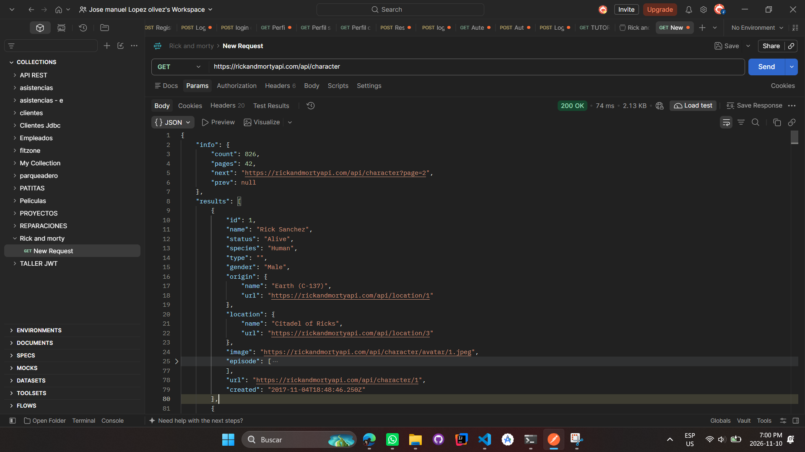
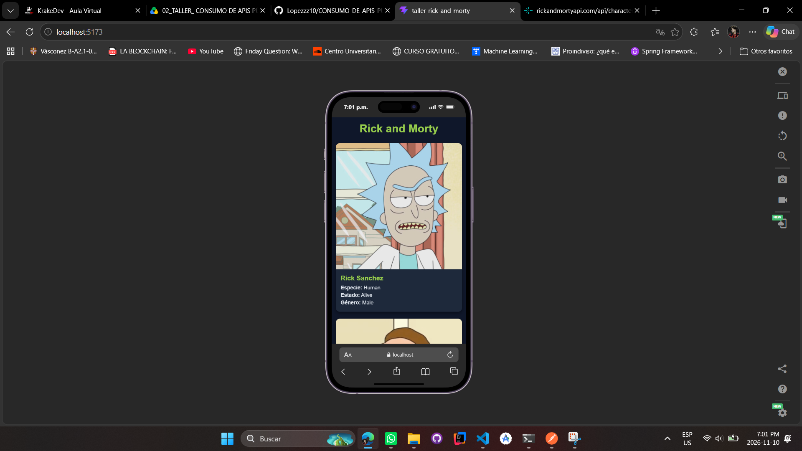

# Rick and Morty: Consumo de API en React

Aplicación en React (con Vite) que consume la API pública de **Rick and Morty** y muestra los personajes en tarjetas con un diseño responsive.

## Objetivo

Desarrollar una aplicación modular que consuma una API REST pública, separando la tarjeta de cada elemento en un componente hijo reutilizable que recibe la información por props.

## Tecnologías

- React 19
- Vite
- CSS (Grid y media queries)
- API: [Rick and Morty API](https://rickandmortyapi.com/api/character)

## Estructura del proyecto

```text
rick-and-morty/
├── capturas/
│   ├── captura1_endpoint_json.png
│   └── captura2_vista_movil.png
├── src/
│   ├── components/
│   │   └── PersonajeCard.jsx   # Componente hijo (recibe el personaje por props)
│   ├── App.jsx                 # Componente padre (consume la API y renderiza el listado)
│   ├── main.jsx                # Punto de entrada de React
│   └── index.css               # Estilos de la cuadrícula y tarjetas (responsive)
└── package.json
```

## Funcionalidades

- Petición GET asíncrona con `fetch` dentro de `useEffect` (carga 20 personajes).
- Estados de carga y de error.
- Componente `PersonajeCard` reutilizable que muestra imagen, nombre, especie, estado y género.
- Listado generado con `.map()`, enviando el objeto completo como prop.
- Diseño responsive con `repeat(auto-fill, minmax(250px, 1fr))`: 1 columna en móviles, 2 en tablets y 4 en escritorio.

## Cómo ejecutarlo

```bash
npm install
npm run dev
```

Luego abre `http://localhost:5173` en el navegador.

## Evidencias

**Captura 1: respuesta JSON del endpoint**



**Captura 2: vista móvil (una sola columna)**

